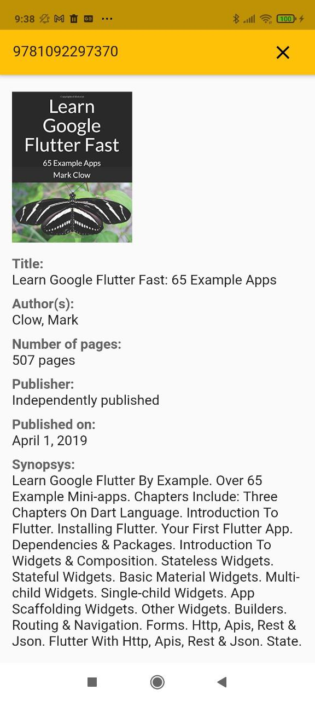

[](https://twitter.com/hikeland)


# Dart/Flutter package for using ISBNdb API

This package is a ready-to-use API for ISBNdb.



⚠️  You need an API key to use this service. To get it, create an account on [ISBNdb](https://isbndb.com/).

You can have a 7-day trial for free.

## Features of the API

This package allows you to use the main ISBNdb API features for books, authors, publishers, and Thema classifications.

Before any request to the API, you need to init the service class with the following code:

```dart
final isbnDb = ISBNdb("your_key_here");
```

## Error handling

All request and parsing failures from `ISBNdb` methods throw `ISBNdbException`.

`ISBNdbException` contains:
- `message`: readable error description
- `method`: HTTP method (`GET`, `POST`, ...)
- `path`: API path (for example `book/9781092297370`)
- `statusCode`: optional HTTP status code (when available)
- `code`: optional machine-readable API reason; HTTP 429 uses `rate_limited`
  for the per-minute limit and `quota_exceeded` for the daily quota
- `cause`: original underlying error

Example:

```dart
try {
  final book = await isbnDb.getBook("9781092297370");
  // use book
} on ISBNdbException catch (e) {
  print("ISBNdb error: ${e.message}");
  print("request: ${e.method} ${e.path}");
  print("status: ${e.statusCode}");
  print("reason: ${e.code}");
}
```

### Pagination

ISBNdb limits `pageSize` to 100 on search and detail endpoints. A larger value
returns `400 Bad Request` for all API keys. The legacy allowance ended on
October 10, 2026. The updated-books feed uses a separate limit of 1,000.
Book searches with a `thema` filter and `getBooksByThema` return at most 1,000
books per code and filter combination; their `total` is capped at 1,000.

### Books

* **Get book details**

```dart
final book = isbnDb.getBook("9781092297370");
final book = isbnDb.getBook("9781092297370", withPrices: true);
```

Param | Description
------------ | -------------
String isbn | an ISBN 10 or ISBN 13 in the Books database
bool withPrices = false | indicate if shows Real Time Prices. Only with the Pro plan

Books expose genre labels through `book.genres` (`List<String>?`), most relevant
first. Labels such as `Children` and `Young adult` identify books for young
readers. The value is `null` when the API omits genres or returns `null`.

```dart
final book = await isbnDb.getBook("9781092297370");
final genres = book?.genres ?? <String>[];
```

* **Get many books with ISBNs**

```dart
final books = isbnDb.getBooksFromISBNs(["9781092297370", "9781680506952"]);
```

This endpoint supports all plans with limits per request depending on your plan:
- Academic: up to 10 ISBNs
- Basic: up to 100 ISBNs
- Pro/Premium: up to 1,000 ISBNs

Param | Description
------------ | -------------
List<String> isbns | a list of ISBN 10 or ISBN 13 in the Books database

* **Search books**

```dart
final books = isbnDb.getBooks(
  "Google Flutter",
  page: 1,
  pageSize: 20,
  edition: 2,
  shouldMatchAll: true,
  language: "en",
  column: BookColumn.title,
  publishedFrom: DateTime(2020, 1, 1),
  publishedTo: DateTime(2024, 12, 31),
);
```

Param | Description
------------ | -------------
String query | A string to search for in the Book’s database
int page | The number of page to retrieve. The API returns up to 10,000 results in total
int pageSize | How many items should be returned per page, maximum of 100
int? year | Filter books by year of publication; cannot be combined with `publishedFrom` or `publishedTo`
int? edition | Filter books by edition
bool? shouldMatchAll | If true, title/author must contain all searched words
String? language | Language filter: ISO 639-3 code (`eng`); ISBNdb also normalizes two-letter codes (`en`) and full names (`English`)
BookColumn? column | Search limited to a column
List<String>? thema | Up to 5 Thema codes; every code must match (narrower codes count)
DateTime? publishedFrom | Only return books published on or after this day; sent as `YYYY-MM-DD`
DateTime? publishedTo | Only return books published on or before this day; sent as `YYYY-MM-DD`

`BookColumn` is an enum with the following values:
* title - Only searches in Books Title
* author - Only searches books by the given Author
* date_published - Only searches books in a given year, e.g. 1998
* subjects - Only searches in subjects; deprecated by ISBNdb and scheduled for removal in a future API version

* **Search books by fields**

```dart
final books = await isbnDb.searchBooks(
  author: "Ursula K. Le Guin",
  thema: ["FBA"],
  pageSize: 20,
);
final byClassification = await isbnDb.searchBooks(thema: ["FBA", "1KBB"]);
```

`searchBooks` uses `GET /search/books` and returns `BookQueryResult`. Supply
`isbn` or `isbn13` for direct lookup, or at least one of `author`, `text`,
`subject` (deprecated), `publisher`, or `thema`. ISBN filters cannot be combined
with those search fields. Invalid combinations are rejected by the API with
HTTP 400. Optional `page`, `pageSize`, `publishedFrom`, and `publishedTo` filters
are supported. Thema lists are sent as comma-separated codes.

### Thema classifications

Thema replaces the deprecated subject headings. Books expose a nullable
`List<ThemaEntry>` as `book.thema`; the main subject comes first with `main: true`.
A book with qualifiers only has no main entry. Codes have a `ThemaType`: `subject`,
`place`, `language`, `time`, `education`, `interest`, or `style`; unrecognized
future response types decode as `unknown`.

```dart
final roots = await isbnDb.getThemaCodes();
final matches = await isbnDb.getThemaCodes(q: "crime", type: ThemaType.subject);
final children = await isbnDb.getThemaCodes(parent: "FB");
final breadcrumbs = await isbnDb.getThemaCodes(
  codes: ["FBA", "1KBB"],
  withAncestors: true,
);
final details = await isbnDb.getThema("FBA");
final books = await isbnDb.getBooksByThema(
  "FBA",
  includeDescendants: true,
  language: "eng",
  page: 1,
  pageSize: 20,
  publishedFrom: DateTime(2020),
);
final search = await isbnDb.getBooks("fiction", thema: ["FBA"]);
```

`getThemaCodes` returns `ThemaListResponse` with `total`, `page`, `pageSize`, and
`codes` (`List<ThemaNode>`). With no filters it lists top-level codes. `q` accepts
2–100 characters; `codes` looks up at most 100 codes and makes `parent`, `type`,
`q`, and paging irrelevant. `withAncestors` adds broader codes before each match.
Paging defaults to `page: 1` and `pageSize: 20`, with a maximum page size of 100.

`getThema` returns `ThemaDetailsResponse` with the code, name, type, optional
parent, ancestors, children, and optional `replacedFrom` for a retired code that
was replaced. `getBooksByThema` returns `ThemaBooksResponse` with the resolved
`thema` node, `books`, `total`, `page`, and `pageSize`. It supports
`includeDescendants` (default `true`), `language`, pagination, and publication
date ranges. ISBNdb normalizes language names and two-letter codes, so `English`
and `en` work alongside ISO 639-3 codes such as `eng` or `fra`. Results stop at
1,000 books; a page starting beyond that limit returns HTTP 400.

### Authors

* **Get author details**

```dart
final book = isbnDb.getAuthor(
  "Bussi Michel",
  page: 1,
  pageSize: 20,
  language: "fr",
  publishedFrom: DateTime(2020, 1, 1),
  publishedTo: DateTime(2024, 12, 31),
);
```

Param | Description
------------ | -------------
String name | The name of an author in the Author's database
int page | The number of page to retrieve, please note the API will not return more than 10,000 results no matter how you paginate them
int pageSize | How many items should be returned per page, maximum of 100
String? language | Language filter: ISO 639-3 code (`eng`); ISBNdb also normalizes two-letter codes (`en`) and full names (`English`)
DateTime? publishedFrom | Only return books published on or after this day; sent as `YYYY-MM-DD`
DateTime? publishedTo | Only return books published on or before this day; sent as `YYYY-MM-DD`

* **Search authors**

```dart
final book = isbnDb.getAuthors(
  "werber",
  page: 1,
  pageSize: 20,
);
```

Param | Description
------------ | -------------
String query | A string to search for in the Author’s database
int page | The number of page to retrieve, please note the API will not return more than 10,000 results no matter how you paginate them
int pageSize | How many items should be returned per page, maximum of 100

### Publishers

* **Get publisher details**

```dart
final book = isbnDb.getPublisher(
  "Nathan",
  page: 1,
  pageSize: 20,
  language: "fr",
  publishedFrom: DateTime(2020, 1, 1),
  publishedTo: DateTime(2024, 12, 31),
);
```

Param | Description
------------ | -------------
String name | The name of a publisher in the Publisher's database
int page | The number of page to retrieve, please note the API will not return more than 10,000 results no matter how you paginate them
int pageSize | How many items should be returned per page, maximum of 100
String? language | Language filter: ISO 639-3 code (`eng`); ISBNdb also normalizes two-letter codes (`en`) and full names (`English`)
DateTime? publishedFrom | Only return books published on or after this day; sent as `YYYY-MM-DD`
DateTime? publishedTo | Only return books published on or before this day; sent as `YYYY-MM-DD`

* **Search publishers**

```dart
final book = isbnDb.getPublishers(
  "Nathan",
  page: 1,
  pageSize: 20,
);
```

Param | Description
------------ | -------------
String query | A string to search for in the Publisher’s database
int page | The number of page to retrieve, please note the API will not return more than 10,000 results no matter how you paginate them
int pageSize | How many items should be returned per page, maximum of 100

### Subjects

ISBNdb has deprecated `getSubject`, `getSubjects`, `Book.subjects`, and
`BookColumn.subjects`. Use `getThemaCodes`, `getThema`, `getBooksByThema`, and
`Book.thema` instead. The deprecated APIs remain available for compatibility;
ISBNdb has not announced their removal date.

* **Get subject details**

```dart
final book = isbnDb.getSubject(
  "Flutter",
  page: 1,
  pageSize: 20,
  language: "en",
  publishedFrom: DateTime(2020, 1, 1),
  publishedTo: DateTime(2024, 12, 31),
);
```

Param | Description
------------ | -------------
String name | A subject in the Subject's database
int page | The number of page to retrieve, please note the API will not return more than 10,000 results no matter how you paginate them
int pageSize | How many items should be returned per page, maximum of 100
String? language | Language filter: ISO 639-3 code (`eng`); ISBNdb also normalizes two-letter codes (`en`) and full names (`English`)
DateTime? publishedFrom | Only return books published on or after this day; sent as `YYYY-MM-DD`
DateTime? publishedTo | Only return books published on or before this day; sent as `YYYY-MM-DD`

* **Search subjects**

```dart
final book = isbnDb.getSubjects(
  "flutter",
  page: 1,
  pageSize: 20,
);
```

Param | Description
------------ | -------------
String query | A string to search for in the Subject’s database
int page | The number of page to retrieve, please note the API will not return more than 10,000 results no matter how you paginate them
int pageSize | How many items should be returned per page, maximum of 100

### Account & API stats

* **Get key details**

```dart
final keyDetails = await isbnDb.getKeyDetails();
```

Returns your API host, plan name, maximum ISBN batch size (`bulkLimit`), and
current usage (`total`, `spent`, `left`). `bulkLimit` is the maximum number of
ISBNs accepted by one `getBooksFromISBNs` request (`POST /books`); it is `null`
for older responses that omit it. The client sends the supplied list as one
request, so keep its size within this limit.

* **Get global API stats**

```dart
final stats = isbnDb.getStats();
```

Returns global dataset counters (`books`, `authors`, `publishers`, `subjects`).

### Feeds

* **Get recently updated ISBNs**

```dart
var feed = await isbnDb.getUpdatedBookFeed(
  pageSize: 100,
  lastUpdated: DateTime(2026, 3, 27),
);
// Process feed.updates here.
while (feed.next != null) {
  feed = await isbnDb.getUpdatedBookFeed(cursor: feed.next, pageSize: 100);
  // Process feed.updates here.
}
```

This endpoint is available on Pro plans and higher, keeps at most 7 days of history,
and does not count against the daily quota according to ISBNdb's OpenAPI docs.
Continue with `feed.next` as the cursor until it is null. When a cursor is supplied,
other filters except `pageSize` are ignored. The client never sends `page`:
ISBNdb 2.9.0 removed it from this endpoint's request and response contract.
Without a cursor, the method's deprecated `page` argument only accepts its default
value of `1`; other values throw `ArgumentError` before any request. With a cursor,
`page` remains ignored for compatibility. Use `cursor` to retrieve following pages.

`UpdatedBookFeed.page` is retained as a deprecated compatibility field and
defaults to `1` when absent or null in a response. The existing four-field
`when`, `maybeWhen`, and `whenOrNull` callbacks remain supported. Read `next`
to continue pagination.

Each entry exposes `UpdatedBook.status`: `UpdatedBookStatus.newBook` corresponds
to the API value `new`, and `UpdatedBookStatus.updated` to `updated`. Older
responses without `status` and unrecognized future values decode as
`UpdatedBookStatus.unknown`. The constructor defaults to `unknown`, and the
existing two-field `UpdatedBook.when`, `maybeWhen`, and `whenOrNull` callbacks
remain supported; read `status` directly from the entry.

Param | Description
------------ | -------------
String? cursor | Opaque `next` cursor returned by the previous response
int page | Deprecated compatibility argument; never sent. Ignored with a cursor; otherwise only `1` is accepted
int pageSize | How many items should be returned per page, maximum of 1,000
DateTime? lastUpdated | Only return ISBNs updated on or after the given day; sent as `YYYY-MM-DD`, ignored with a cursor

## Testing

- Offline tests: `flutter test --exclude-tags live`
- Live tests (requires secret): `ISBNDB_API_KEY=your_key flutter test --tags live`

Live tests are skipped automatically when `ISBNDB_API_KEY` is not set.

## API monitoring (maintainers only)

You do not need this section to use the package in your app.

- OpenAPI snapshot reference: `api/upstream/isbndb-openapi.json`
- API documentation snapshot: `api/isbndb-api-documentation-v2.md`
- Stable smoke fixtures used by live tests: `api/smoke/known_queries.json`
- Drift check script: `./scripts/check_api_spec_changes.sh`
- Scheduled GitHub Action: `API Spec Watch` (`.github/workflows/api-spec-watch.yml`)
- When drift is detected, `API Spec Watch` classifies version metadata,
  structural contract changes, and behavioral description changes. It includes
  the report in the `api-drift` issue and fails the workflow.

Configure one repository variable or secret named `ISBNDB_OPENAPI_SOURCE_URL` to enable the scheduled OpenAPI drift check.

## Code generation (maintainers only)

You do not need this section to use the package in your app.

Regenerate `freezed`/`json_serializable` files with:

```sh
./scripts/generate.sh
```

This script also clears stale local `build_runner` snapshots before generation.

## Models

**AuthorQueryResult**

Name | Type | Description
------------ | ------------- | -------------
total | int | Number of results
authors | List<String> | An array containing the authors

**Author**

Name | Type | Description
------------ | ------------- | -------------
author | String | The name of the author
books | List<Book> | An array containing the books of this author

**BookQueryResult**

Name | Type | Description
------------ | ------------- | -------------
total | int | Number of results
books | List<Book> | An array containing the books of this query
page | int? | Current page for paginated search responses
pageSize | int? | Page size for paginated search responses

**Book**

Name | Type | Description
------------ | ------------- | -------------
title | String | Title of the book
titleLong | String | Long version of the title
isbn | String | ISBN 
isbn13 | String | New 13-digit ISBN
deweyDecimal | String | Not documented in the official API
binding | String | Not documented in the official API
publisher | String | The name of the publisher
datePublished | DateTime | Date when the book was published. Partial dates are normalized to the first day of their period.
edition | String | Deprecated string edition; use `editionNumber`
editionNumber | int | Numeric edition of the book
pages | int | Number of pages of the book
dimensions | String | Dimensions of the book
overview | String | Not documented in the official API
image | String | Cover image URL (maximum height 450px); may be a placeholder when no cover is available
msrp | double | Deprecated USD list price; use `listPrice`
listPrice | ListPrice | List price with its currency
excerpt | String | Deprecated excerpt of the book
synopsys | String | Synopsys of the book
authors | List<String> | List of the authors
subjects | List<String> | Deprecated list of subjects; use `thema`
thema | List<ThemaEntry>? | Thema subject codes and qualifiers; main subject first when present
genres | List<String>? | Genre labels, most relevant first; `null` when omitted or returned as `null`
reviews | List<String> | Not documented in the official API
prices | List<Merchant> | Real-time prices returned by `getBook` when `withPrices` is enabled and supported by the plan
related | List<String> | Not documented in the official API

The existing `Book.when`, `maybeWhen`, and `whenOrNull` callbacks remain
compatible. Access `thema` and `genres` directly on the book.

**ThemaEntry**

Name | Type | Description
------------ | ------------- | -------------
code | String | Thema code
name | String | English name
type | ThemaType | Subject or qualifier type; unknown future types decode as `unknown`
main | bool | Whether this is the book's main subject

**ThemaNode**

Name | Type | Description
------------ | ------------- | -------------
code | String | Thema code
name | String | English name
type | ThemaType | Subject or qualifier type
parent | String? | Parent code; absent for a top-level code
hasChildren | bool | Whether narrower codes exist

**ListPrice**

Name | Type | Description
------------ | ------------- | -------------
amount | double | Price amount, rounded to two decimal places by ISBNdb
currency | String | ISO 4217 currency code

**Merchant**

Name | Type | Description
------------ | ------------- | -------------
condition | String | Number of results
merchant | String | Name of the merchant
merchantLogo | String | URL of the merchant logo
merchantLogoOffset | Map | Not documented in the official API
shipping | String | Shipping cost
price | String | Price of the book
total | String | Not documented in the official API
link | String | Link to the purchase url

**PublisherQueryResult**

Name | Type | Description
------------ | ------------- | -------------
total | int | Number of results
publishers | List<String> | An array containing the publishers

**Publisher**

Name | Type | Description
------------ | ------------- | -------------
name | String | The name of the publisher
books | List<Book> | An array containing the books of this publisher

**SubjectQueryResult**

Name | Type | Description
------------ | ------------- | -------------
total | int | Number of results
subjects | List<String> | An array containing the subjects

**Subject**

Name | Type | Description
------------ | ------------- | -------------
subject | String | The subject
books | List<Book> | An array containing the books related to this subject

**KeyDetails**

Name | Type | Description
------------ | ------------- | -------------
apiHost | String | API host attached to your key
planName | String | Name of the subscription plan attached to your key
planLimit | PlanLimit | Usage details of the current API plan
bulkLimit | int? | Maximum ISBNs per `POST /books` request; `null` when absent from older responses

The existing three-field `KeyDetails.when`, `maybeWhen`, and `whenOrNull`
callbacks remain compatible. Access `bulkLimit` directly on the model.

**PlanLimit**

Name | Type | Description
------------ | ------------- | -------------
total | int | Daily request allowance shared by every key in the subscription
spent | int | Requests charged today across the subscription
left | int | Requests remaining under whichever subscription or key allowance is lower
keyTotal | int? | Daily allowance attached to this key, or `null` when it has no cap
keySpent | int | Requests charged today to this key; defaults to `0` when omitted
keyLeft | int? | Requests remaining for this key, or `null` when it has no cap
limitedBy | PlanLimitAllowance | Allowance that determines `left`: `subject`, `key`, or `unknown`

**Stats**

Name | Type | Description
------------ | ------------- | -------------
books | int | Number of books indexed by ISBNdb
authors | int | Number of authors indexed by ISBNdb
publishers | int | Number of publishers indexed by ISBNdb
subjects | int | Number of subjects indexed by ISBNdb

## Third party packages

This app uses some external librairies:

- [x] [Freezed](https://pub.dev/packages/freezed) to generate immutable models
- [x] [Dio](https://pub.dev/packages/dio) for http requests

## Credits

This package was originally created for my personnal needs but feel free to use it, it covers all the features of the ISBNdb API and I will maintain it.

I am not related to ISBNdb in any way, I am just a developer who needed to use this API and created this library to do so.

If you have questions, feel free to ask on [Twitter](https://twitter.com/hikeland).

## [LICENSE: MIT](LICENSE.md)
